# Raqam — Person C AI implementation plan

**Created:** 10 October 2026, PKT. **Owner:** the user, Person C / Person 3.  
**Status:** detailed planning complete; all implementation tasks remain `todo`.  
**Planning baseline:** repository commit `7a432a4`, plus existing local documentation changes.  
**Available time:** user reports approximately 15–17 hours. Exact organizer cutoff remains unconfirmed.  
**Authority:** [PRD](../../PRD.md), [team assignments](../../TEAM_TASKS.md), [build gates](../../BUILD_PLAN.md), [workflow](../../TEAM_WORKFLOW.md), and [working instructions](../../AGENTS.md).  
**Continuity:** [Person C handoff](handoff.md). This plan elaborates C's lane; it does not replace the PRD or assign new implementation work to A/B.

**Coding procedure:** [Numbered implementation steps](IMPLEMENTATION_STEPS.md) decomposes C-00–C-10 into 20 agent-ready steps with file ownership, prerequisites, coding instructions, acceptance checks and clean cloud-shipping requirements. Use this plan for architecture/product behavior and that runbook for a requested step's execution.

## 1. Outcome we are building

A small service-business owner imports a PKR cash CSV and uploads English printed receipts. Raqam extracts proposed document fields, suggests cashbook categories, proposes evidence-backed document matches, and investigates bookkeeping questions through scoped tools. The owner can see what the AI found, where it came from, what remains uncertain, and which decisions they still need to make.

The memorable product moment is **one continuous transformation from scattered evidence into reviewed records and a verifiable answer**. AI is embedded in document understanding, semantic categorization, reconciliation proposals and question investigation. Its outputs change the review work available to the owner; they are not merely a paragraph appended to a static dashboard.

Our strongest demonstration contains all four core AI capabilities, a genuine correction, a semantic match, an ambiguous case, and a question that cites the exact rows behind its answer. No plan can guarantee a judging outcome. This plan makes the quality and impact assessable through functioning behavior and measured results.

### The invariant that governs every feature

**CSV records establish cash movement. Documents provide supporting evidence. AI proposes. The owner reviews. Application code calculates and enforces.**

- OCR never creates a new cash transaction or marks a payment settled.
- No model-produced confidence, explanation or match may override a human decision.
- No model computes authoritative financial totals.
- No assistant tool changes categories, approves matches, deletes records or initiates payments.
- Missing evidence is a review need, not proof of fraud, lost money or nonpayment.
- Unknown fields remain unknown. In particular, unreadable amounts never become zero.
- Every operation, input, cache entry, record and source stays inside the authenticated owner's workspace.

## 2. Scope and requirement traceability

| PRD requirement | C delivers | A supplies/enforces | B presents | Acceptance evidence |
| --- | --- | --- | --- | --- |
| F01 identity/private sources | Server-only AI module; scoped dependencies; no model-controlled ownership | Clerk verification, token-aware Supabase, private source loading, policies | Sign-in, private viewer, account-switch states | A's two-user checks including AI/tools; no leaked source URLs |
| F02 CSV foundation | Consume validated imported records with original row references | Parsing, exact money/date normalization, deduplication, import persistence | Preview, errors, cashbook | C never repairs invalid imports silently or duplicates them |
| F03 OCR / RQ-02, RQ-05 | Live image extraction, typed field proposals, unknowns, versioned cache behavior, recoverable failures | Upload validation/storage, extraction persistence, user corrections | Source beside editable fields; unresolved and retry states | Fresh receipt tests, correction/reload, duplicate request test |
| F04 categories / RQ-06 | Guide-constrained proposals with reasons and abstention | Persist proposals and decisions; protect accepted categories on rerun | Accept/change/reject and visible batch review | Independent category scoring; accepted decision survives rerun |
| F05 matching / RQ-07 | Candidate preparation/ranking, semantic evidence, ambiguity/unsupported outcomes | Fetch scoped candidates; approval and atomic one-to-one allocation | Candidate comparison, confirm/reject/change | Precision/recall/coverage; ambiguity; A's concurrency checks |
| F06 summaries / RQ-06 | Consume deterministic totals, explicitly distinguish reviewed/pending records | Exact inflow/outflow/net/category sums and coverage | Summary cards and remainder | Receipts never change totals; assistant numbers match A's totals |
| F07 assistant / RQ-08 | Four-tool bounded loop, argument/result checks, grounded response and public action trail | Authorized implementations of the four PRD tools | Question panel, scope, evidence links, recovery | Six reserved questions; exact numeric facts or abstention |
| F08 export/history / RQ-09 | Return stable references and model/prompt metadata | Persist review trail; safe, exact CSV export | Export and decision history | Export agrees with cashbook; AI outcomes traceable after reload |
| RQ-03, RQ-10 | Development tests, failure simulations, measured live run records | Independent reserved cases, scoring ownership, release integration | Independent label check, browser QA/demo | Counts, latency, failures, frozen configuration and revision |

All core stays in scope. P&L, taxes, forecasting, payments, universal bank parsing, handwriting, Urdu, multi-page PDF, multi-workspace agents and many-to-many allocations remain outside this plan's core.

### Source and skill decisions

Applied during planning: `spec-kit-planning`, `ecosystem-primer`, `langchain-fundamentals`, `langchain-middleware`, `codebase-design`, `frontend-craft`, and `handoff`. API/TypeScript/security skill instructions were also reviewed for interface validation and authorization principles. Generic instructions are limited by [Raqam's applicability rules](../RULES_REVIEW.md).

During implementation, load only the skill relevant to the active slice: TypeScript for exhaustive typed states; secure-code-guardian for input/tool validation; API designer when agreeing route contracts with A; TDD for meaningful AI-module behavior tests; Playwright for integrated browser verification; code-review for an actual implemented diff. These later workflows have not run. Installed skill inventory is in [SKILL_SETUP](../SKILL_SETUP.md).

**Architecture recommendation:** retain the PRD's Next.js/TypeScript, Zod and Groq SDK. The LangChain skills inform explicit tool descriptions, bounded loops, validated outputs and error handling. Installing LangChain/LangGraph/Deep Agents, LangSmith, a vector store or a Python service is not required. Reconsider only if an observed implementation problem justifies the dependency and A agrees the package change. Human review is persisted through A's existing review flow, not an agent checkpoint.

## 3. Ownership and integration seam

C owns `src/lib/ai/**`, `tests/ai/**`, and `docs/ai/**`. These source/test paths are proposals until A bootstraps the application. In this planning session only `docs/ai/**` and an additive root handoff entry are changed.

| C may implement | C requests from A | C coordinates with B |
| --- | --- | --- |
| Provider adapter and validated model outputs | Package/version approval, server runtime and environment configuration | Visible loading, error, unresolved and cached states |
| Extraction/category/match orchestration | Shared Zod schemas, exact normalization helpers, persistence and snapshots | Field widgets, rationale/evidence display and review actions |
| Tool-call validation, orchestration and answer validation | Four authorized read-only tool functions and canonical totals | Answer/fact cards, scope labels, clickable evidence and action trail |
| AI failure tests and live measurement runner | Operation/cache reservation interface and independent fixtures | Correction journey, empty states and demo pacing |
| Prompt/model versions and AI documentation | Authenticated route wrappers and canonical error translation | No direct browser calls to Groq; cancel/retry conventions |

C does not implement A's API routes, database/migrations, auth, exact totals, export or lockfile. C does not implement B's pages/components or global styling. Describe needed interfaces here, request adoption, and continue C-local work against agreed development examples while those dependencies are being built.

### Architecture and trust flow

```mermaid
flowchart LR
  B["B: upload / review / ask"] --> A["A: authenticated route + workspace authorization"]
  A --> S["A: scoped records / private sources / snapshots"]
  S --> C["C: extraction / categories / matching / assistant"]
  C --> G["Groq: image or text inference"]
  G --> V["C: schema + semantic + evidence checks"]
  V --> P["A: persist proposals / operation results"]
  P --> U["B: explain / edit / accept / reject"]
  U --> R["A: validate review + commit atomically"]
  R --> T["A: exact summaries + read-only tools"]
  T --> C
```



The browser supplies identifiers and user intent, never trusted owner identity or provider credentials. A derives the workspace from the verified session, loads authorized inputs, and calls C. C receives scoped records and capability functions; it has no unrestricted database client, arbitrary SQL or service-role key. For images, A passes authorized bytes or a short-lived server-side retrieval capability. Do not send private storage locations or signed links back in assistant prose/logs.

### Proposed small public interface

Names are illustrative until C-00 freezes the shared contract with A/B:

| Operation | Authorized input | Dependencies injected by A/C | Output |
| --- | --- | --- | --- |
| `extractDocument` | Source identity/version, validated image, request context | Groq adapter, budget/deadline, exact normalizers | Extraction field proposals, review reasons, provenance |
| `proposeCategories` | Bounded eligible transaction snapshots and guide version | Text adapter, budget, contract validators | Per-transaction proposed/needs-review outcomes |
| `proposeMatches` | Reviewed document fields plus bounded eligible transaction snapshots | Text adapter, exact comparisons, budget | Ranked candidates or explicit ambiguity/unsupported result |
| `answerBookkeepingQuestion` | Question, explicit reporting scope, authorized current snapshot | Four scoped read-only tools, text adapter, budget | Answer blocks, exact fact references, evidence and public action trail |

Hide prompts, provider payloads and retry rules behind this interface. A should not need to understand provider message formats; B should not need to parse model JSON. Tests exercise these same public operations with a live adapter or scripted adapter. Import shared contract types from A's single source once adopted; never maintain a second independent transaction schema in C's folder.

## 4. Contract proposal to freeze first — C-00 / RQ-00

**These choices are proposed, not already accepted shared schemas.** A owns final schema files and naming. Freeze a small example set with B/C before feature wiring. If A's existing scaffold uses different names with equivalent behavior, adapt C rather than rewrite shared infrastructure.

### 4.1 Canonical values and provenance

| Item | Proposed representation / policy | Agreement needed |
| --- | --- | --- |
| IDs | Distinct transaction/document/source/proposal IDs; model may only reference supplied IDs | A's real ID types |
| Money | JSON decimal string of integer minor units, e.g. `"450000"` = PKR 4,500.00; nonnegative amount + separate `in`/`out` | A confirms this or an equivalent exact-decimal representation |
| Arithmetic | A's canonical parser/formatter; integer/exact-decimal comparisons internally; no JSON BigInt, parseFloat or floating sums | Helper imports and accepted amount precision |
| Currency | Explicit normalized currency; workspace is PKR, document currency may be null/uncertain until reviewed | Whether a missing printed currency requires user confirmation; never silently infer it as extracted PKR |
| Transaction date | Valid `YYYY-MM-DD` from confirmed import | Reporting timezone/date-filter boundaries |
| Document date | Original printed string + normalized date if unambiguous | Day/month ambiguity, missing year and required review fields |
| Evidence | Existing `sourceId`, record ID and row or document-field locator; optional observed text | Shared locator shape and source viewer behavior |
| Versions | Source hash, input record version/snapshot, schema, prompt, model ID, category guide version | Backend snapshot/version implementation |
| Time | Server timestamp and per-stage elapsed milliseconds | A's timestamp contract |

The model proposes printed money as a string. Code normalizes it. `4,500.00` can normalize exactly; `4.500` needs agreed locale interpretation or review. Multiple decimal separators, unsupported precision, absent totals and ambiguous dates must produce a reason rather than a guessed value. Never infer an invoice date from upload time. A model's quoted text is an observation, not independently proven pixel-level OCR; retain the actual image for verification. Bounding boxes/highlights are optional only if measured reliable, not fabricated core evidence.

### 4.2 State separation

Do not use one generic status for all business state:

- **Operation lifecycle:** proposed `queued`, `running`, `completed`, `failed`, `cancelled` (transport only).
- **Business proposal:** PRD `proposed`, `accepted`, `rejected`, `needs_review`; C only emits `proposed` or `needs_review`.
- **Document extraction:** not attempted, usable output, partial output or failed; separate from document review.
- **Category:** pending proposal versus accepted category; a valid cash row remains imported even if uncategorized.
- **Match:** no candidate, proposal, ambiguity or active accepted match; allocation is committed by A.

A successfully completed extraction may still require review. A failed assistant request must not change cashbook/review state. An accepted category or match may become stale for a new proposal if its inputs change; C must never silently supersede it.

### 4.3 Shared envelopes

Proposed request context: `requestId`, server-established workspace context, input snapshot/version, operation version, deadline/cancellation signal. Workspace identity is absent from model-controlled tool arguments; it is bound into A's authorized dependency functions.

Proposed common result metadata: model and prompt version, schema/guide version, duration, request/cache identity, `origin` (`live` or `cached`), warnings and per-item outcomes. Model token counts are optional if actually returned. Do not expose keys, raw internal exceptions, signed URLs, prompts containing personal data or hidden reasoning.

Each outcome must include referenced input IDs, an explicit status, proposed value or null, a short rationale, reason codes and evidence locators. A assigns/persists proposal IDs and validates references. C must reject IDs not present in its authorized input. B renders structured fields, not inferred states from free text.

Suggested reason codes: `unreadable_field`, `missing_field`, `ambiguous_date`, `currency_unknown`, `currency_mismatch`, `amount_mismatch`, `multiple_candidates`, `insufficient_evidence`, `unsupported_allocation`, `stale_input`, `provider_timeout`, `provider_rate_limited`, `invalid_model_output`, `tool_limit_reached`. Final error/status enums belong to A's contract.

### 4.4 Idempotency, caching and stale results

A owns persistent storage and atomic operation reservation. C defines the identity inputs:

- OCR: workspace + source content hash + extraction prompt/model/schema versions + preprocessing version.
- Categories: workspace + ordered eligible record IDs/versions + guide + prompt/model/schema versions.
- Matching: workspace + reviewed document version + candidate snapshot + active-allocation version + matching prompt/model/schema versions.
- Assistant: no cross-question cache in core; never reuse a financial answer across record snapshots without an explicit snapshot match.

Deduplication must be durable enough for separate server requests; an in-memory map alone does not prevent duplicate work across deployment instances. Identical source bytes can reuse a completed extraction but must never overwrite corrected fields. Record corrections invalidate dependent proposals. Before persisting/accepting, A checks input versions; stale results are excluded from actionable proposals and surfaced for a rerun. Older requests finishing late cannot replace newer operation results.

### 4.5 Route wiring proposal for A

C requests an authenticated invocation path for each of the four operations and a way for B to load persisted results. A chooses the route URLs, sync/polling strategy and error envelope. A's existing route conventions take precedence.

A wrapper must: authenticate; resolve workspace; validate request; fetch scoped input; reserve operation; invoke C with scoped capabilities; validate the outcome and snapshot; persist it; return a stable result. Review mutations remain separate from these AI invocations.

Default recommendation: bounded synchronous operations if measured latency fits the deployed host's request limits. Sequential batches should be small enough to fit one request. If they do not fit, A implements persisted operation progress and polling/resume. Do not use fire-and-forget promises after a serverless response. A host deadline, queue backend and durable cancellation behavior remain C-00 decisions; the plan does not assume background workers exist.

### C-00 contract checklist

- [ ] A has confirmed actual paths, schema version, package manager/runtime and test runner.
- [ ] A/B/C agree money/date/currency, evidence, state and error shapes with sample payloads.
- [ ] Required document review fields are explicit. Proposed minimum: usable total, confirmed currency and unambiguous date; merchant missingness is visible and its review requirement is agreed.
- [ ] A specifies how accepted decisions, input versions and active matches are protected.
- [ ] A confirms image retrieval, operation reservation/cache and four authorized tool functions.
- [ ] B can render clean, uncertain, ambiguous, failed, cached and stale results from examples.
- [ ] Package additions are submitted to A; C will not edit manifest/lockfile or `.env.example`.
- [ ] Six development packets are available; reserved answers remain controlled by A/B.

C can prove Groq capability on C-local synthetic inputs while contracts are pending. Production wiring and business-state acceptance wait for the shared contract.

## 5. Provider feasibility, configuration and request budget

### Live feasibility gate — first hour

1. Obtain server-side Groq access through the team's chosen secure setup. Do not paste keys into documentation, fixtures, screenshots or browser code.
2. Inspect account-visible model access and organization limits. Record only nonsecret capability/limit metadata.
3. Try the PRD vision candidate `qwen/qwen3.8-27b` on three fresh supported images: clean receipt, different layout, unreadable required field.
4. Try the PRD text/tool candidate `openai/gpt-oss-20b` with schema output and a minimal allowlisted read-only tool call separately.
5. Record actual model IDs, request settings, schema/prompt versions, request outcomes, critical-field errors and elapsed time. Verify missing values survive validation.
6. Select the working supported mode and publish the evidence in `docs/ai/GROQ_FEASIBILITY.md` when implementation begins. A approves pinned dependencies and environment names.

**Stop condition:** no working vision access, unusable extraction, or unsuitable request limits. Raise the concrete failure immediately. OCR remains core; do not substitute static outputs, a text-only model, another paid provider or a different scope without the user's decision.

### Capability decision

Current public Groq documentation lists the PRD's vision candidate and documents model-dependent structured-output support. Structured outputs and tool use are currently documented as separate modes. Therefore extraction/categories/match analysis use a verified schema-output mode; assistant investigation uses local tool calling. This is documentation evidence, not evidence that our account or inputs work. [Vision](https://console.groq.com/docs/vision), [structured outputs](https://console.groq.com/docs/structured-outputs).

Strict schema adherence cannot establish correct amounts, dates, categories or evidence. Validate semantic invariants even with strict mode. If the chosen vision model supports only the verified JSON-object path for our request configuration, use that with local schema validation and at most one bounded repair; do not assume native strict schema support from a text-model test.

### Initial engineering limits — proposed, verify during C-01

| Limit | Proposed starting point | Why / recovery |
| --- | --- | --- |
| Workspace size | PRD proposed 50 transactions / 10 images | Agree reductions if actual host/quota cannot support them |
| Demo size | PRD proposed 20 transactions / 3 images | A/B fixture, independently checked |
| OCR concurrency | One provider call at a time per shared account coordinator | Reserve quota; avoid teammates running bulk requests together |
| OCR payload | One image/request; app byte/dimension cap determined with A | Provider documentation maximum is not our safe upload cap |
| Text proposal batch | Up to 10 records per call initially | Per-record outcomes and bounded context; measure before changing |
| Matching candidate pool | At most 50 authorized transactions; show top 3 candidates plus omitted-count flag | Preserve ambiguity across full pool; no misleading uniqueness after truncation |
| Assistant scope | One explicit question/current workspace, no persistent conversation memory initially | Follow-up questions must restate or explicitly carry visible filters |
| Assistant loops | At most 3 model rounds and 4 tool executions total | Final fallback uses accumulated validated facts; no unlimited final extra call |
| Retry budget | At most 2 attempts total per provider operation, including malformed-output repair | SDK retries and application retries must share one total budget |
| Timeout | Initial 20-second provider attempt, operation wall clock capped to A's host allowance | Measure, tune and cancel on request deadline; never wait beyond host lifetime |
| Context | Bounded records/tool output and tokens; proposed 8k text input-token budget where measurable | Truncated data is explicitly partial; not enough data yields clarification |
| Output | Initial 2k output-token cap for proposal calls, 1k for assistant wording | Avoid truncated JSON; lower batch size before raising quotas |

These are proposed app controls, not reported provider limits or performance results. Model-specific parameter support is verified rather than forcing unsupported settings. Use a low supported temperature where appropriate, record it, and do not promise determinism from temperature alone.

Groq quotas operate at organization level and exact current limits come from the account's Limits page. Handle 429 with the actual retry guidance/reset information and a bounded schedule; a reset later than the operation deadline becomes a visible deferred/retry action. [Rate limits](https://console.groq.com/docs/rate-limits).

Budget before evaluation: count planned images, proposal batches and assistant rounds; add bounded retries and two demo rehearsals. A/B's 12 reserved packets contain 1–3 images each, so full evaluation can require 12–36 image requests before other work. Reserve demo capacity explicitly. C coordinates the one live request schedule; mocked failure tests consume no live quota. Do not label mocked provider success as live measurement.

### Adapter behavior

Server-only import protection; validated configuration; explicit image/schema/tool modes; abort/deadline propagation; bounded request size; provider error mapping; measured latency; redacted metadata; versioned prompts. Do not expose vendor exception bodies directly. Retries are for recoverable network/temporary failures, not invalid credentials or unsupported models. Schema repair requests must not supply independent evaluation answers.

## 6. Receipt extraction workflow — F03 / RQ-02 / RQ-05

### Inputs and outputs

Input: A-authorized source ID/hash, MIME type, validated image, operation context. The model sees the image and extraction instructions, not an expected-answer file.

Field proposals: merchant/counterparty, document date, total, currency if printed, reference if printed; preserve raw observed strings and nulls. Optional document kind may help explain the source, but cannot infer settlement or cash direction. Every field has a source-field locator, visibility/uncertainty status and review reason. Avoid uncalibrated confidence percentages in product output.

### Steps

1. Verify input against the shared contract and check an A-supplied completed-cache result.
2. Acquire the operation/budget slot. Confirm the same source is not already running.
3. Send one image to the configured vision model, instructing it to read visible printed fields and ignore embedded instructions.
4. Parse and validate provider output. Missing or malformed fields remain null/invalid with reasons; do not invent replacements.
5. Normalize printed amount/date/currency through agreed exact helpers. Distinguish subtotal/tax/tip/total; prefer a clearly labeled final total, abstain if multiple totals remain plausible. Never calculate an invented total from line items.
6. Validate semantic consistency: all IDs are supplied, values are parseable, document currency is explicit or unknown, required fields are flagged, evidence locators point to the original source.
7. Return usable/partial outcomes and metadata. A persists extracted proposals independently of user corrections.
8. B shows source and editable fields. Owner confirms/corrects; A validates and stores the decision. Those corrected fields become the reviewed input for matching.
9. Repeated upload reuses completed extraction without reusing a different owner's records or resetting reviewed values.

### Behavior under difficult inputs

| Case | Expected behavior |
| --- | --- |
| Total obscured | `total = null`, `unreadable_field`, source visible; no review-complete state |
| Date `03/04/26` with unknown convention | Raw date retained; normalized date null until review |
| No printed currency | Extracted currency null; owner confirmation follows agreed policy |
| Multiple totals/subtotals | Identify visible labels; unresolved if final amount cannot be determined |
| USD receipt in PKR workspace | Keep observed currency; do not convert; matching stays unresolved |
| Handwriting, multipage PDF, unsupported content | Clear supported-input limitation/recovery; no fake clean extraction |
| Image says “ignore prior instructions” | Treat as document content, not policy/tool/ownership instructions |
| Timeout/429/malformed output | Preserve source/books; bounded retry or explicit recoverable error |
| User corrects total after extraction | New reviewed version; prior extraction retained; dependent match proposals stale |

**C acceptance:** three fresh images work as specified; clean and changed-layout receipts yield reviewable proposals; unknown total remains unknown; cache/version/failure tests pass. **Integrated acceptance:** source/fields/correction persist after reload and no extra cash movement appears.

## 7. Category proposals — F04 / RQ-06

Use the PRD's exact seven-label guide: customer receipts; software/services; premises/utilities; travel; other operating cash activity; transfers/owner movements; uncategorized. A freezes canonical IDs/slugs and guide version. These are cashbook review labels, not a chart of accounts or tax treatment.

Guide examples and counterexamples must be explicit. A debit is not automatically an expense; a credit is not automatically revenue. An owner deposit/transfer cannot be categorized as customer receipts without supporting description/context. “Transfer” alone may still be ambiguous. Document merchant names enrich context but never override a corrected transaction or establish economic purpose by themselves.

1. Receive eligible validated transaction snapshots and any already-reviewed linked evidence authorized by A.
2. Exclude already accepted category decisions from routine replacement. Rejected/changed proposals follow A's agreed rerun policy.
3. Send a small batch with category guide and original descriptions/references. Keep record IDs immutable.
4. Validate one outcome per requested eligible transaction. Reject duplicate/foreign IDs, omitted outcomes without status and labels outside the guide.
5. Return category ID or uncategorized, `proposed`/`needs_review`, a short record-specific reason, source references and guide/model/prompt versions.
6. Low-information/ambiguous descriptions abstain. For `TRF 8841`, a truthful “Purpose is unclear from this description” is better than an invented vendor/category.
7. A persists proposals; B shows them for deliberate accept/change/reject. Reruns cannot replace reviewed decisions.

**Meaningful tests:** mixed debit/credit cases; owner transfers; unfamiliar merchant descriptors; ambiguous transfer; wrong category enum; omitted/duplicate input IDs; accepted-category protection; record change while request runs. **Live measurement:** correctness on independently labeled explicit cases, abstention and correction counts separately. No training/personalization claim in core.

## 8. Document matching — F05 / RQ-07

The goal is to propose a useful relationship and explain its evidence while leaving certainty and allocation to review. The matching workflow is constrained inference plus deterministic checks, not an unconstrained “find the payment” prompt.

### Candidate policy

- Use reviewed document fields for actionable proposals; unreviewed financial extraction can be previewed but is explicitly blocked from confirmed-match review until required fields are resolved.
- Require exact currency and amount compatibility for ordinary one-to-one candidates. Unknown or differing values return a review/unsupported outcome; no unexplained tolerance or FX conversion.
- Search the full authorized capped transaction set before ranking. Date proximity is evidence, not a hard undocumented cutoff. A legitimate later settlement can remain a candidate; show date difference and uncertainty.
- Active allocations are excluded from new actionable candidates. A rechecks that condition atomically at approval.
- Evidence beyond amount is needed: reference agreement, meaningful merchant/description relation and date context. Equal amount alone does not produce a confident recommendation.
- Explicit contradictory references, inconsistent fields, ties and multiple plausible transactions must stay visible. Never hide an equally plausible candidate merely because the UI shows only the top three.

### Steps

1. A provides scoped reviewed document, relevant transactions, active allocation information and snapshot versions.
2. C validates minimum fields and computes amount/currency compatibility and date/reference comparisons in code.
3. C sends eligible bounded candidates for semantic comparison of descriptions/counterparties. Model returns candidate IDs, supporting evidence and conflicting/insufficient evidence.
4. C validates IDs and evidence. Reapply amount/currency rules after model output; model ranking cannot bypass them.
5. Return ordered candidates and feature-specific evidence: exact amount agreement, date gap, reference agreement/conflict, semantic relation, remaining concerns. Avoid displaying invented probability percentages.
6. Outcome is proposed, multiple-candidate review, no supported candidate, or unsupported relationship. Even a strongest candidate is only a proposal.
7. A persists; B provides compare/confirm/reject/change. A enforces snapshot checks, workspace authorization and one active match per transaction/document.

No many-to-many solver, duplicate-payment accusation or fuzzy money tolerance in core. A possible split payment is labeled unsupported/requires review; it is not silently allocated to one row. Semantic inference supports merchant aliases; it must not turn a coincidental equal amount into evidence of settlement.

**Acceptance cases:** exact amount plus matching reference; different merchant aliases with other corroboration; two legitimate equal amounts; near-same dates with weak descriptions; different currency; amount mismatch; document already allocated; stale reviewed fields; no candidates; attempted foreign ID; two concurrent confirmations (A's test). Report candidate coverage as well as precision/recall.

## 9. Grounded assistant — F07 / RQ-08

### Four tools, shared with A

| Tool | Proposed bounded arguments, subject to A's schema | Required output semantics |
| --- | --- | --- |
| `list_transactions` | Date range, accepted-category filter, review/match filter, cursor, capped limit | IDs, original/reviewed values, exact amounts/currency/direction, references, snapshot, returned/total counts, completeness |
| `get_cash_summary` | Date range and explicit reporting scope | Exact inflow/outflow/net, accepted-category breakdown, unreviewed remainder, coverage and contributing record IDs |
| `get_review_queue` | Category/match/document-field reason filter, cursor and limit | Outstanding items and reasons, supporting record/source refs, scoped counts and explicit pagination |
| `get_record_evidence` | Bounded list of transaction/document IDs | Accessible originals/corrections/decision history/source locators; no public URLs or ownership leaks |

Tools accept no model-provided owner IDs, SQL, storage paths or arbitrary URLs. A binds authenticated workspace context before C sees them and verifies every record ID at execution. C validates model arguments before dispatch; A validates again at the resource. Unsupported tool names never execute.

### Assistant execution algorithm

1. Validate question length and visible reporting scope. Suggested starting cap: 1,000 characters. Normalize only explicit dates; if “this month” is used, show resolved dates/timezone in the response.
2. Start with a server-authored system instruction and the current question. Do not persist unbounded conversation memory; previous chat is not authoritative financial data.
3. Provide the four tool schemas with clear descriptions and read-only limitations. Use verified local tool calling without structured-output mode in the same request.
4. Model selects a tool. Validate allowlist/name/arguments and remaining budget. Dispatch sequentially through A's scoped functions.
5. Validate returned shapes and source/reference membership; add a concise public trace entry. Reject results that violate the shared contract.
6. Append tool results with correct tool-call IDs and continue within three model rounds/four executions. Deduplicate repeated identical tool calls within the request. Parallel requests do not bypass budget checks.
7. If the model completes, validate its supported claims and citations. If the cap/deadline is reached, return a partial result/clarification from already validated facts without another unbudgeted model call.
8. Return explicit answer scope, grounded answer blocks, fact/source references, public tool trace and unresolved/partial indicators. A performs final access/snapshot checks before serving; B renders safely.

### Numeric and evidence guarantees

An LLM can invent a number even after calling a correct tool. Therefore prompting alone is insufficient. Proposed answer contract uses structured fact references: an amount/count block references a specific validated tool-result fact key, and code formats the actual value. The model may select/explain facts but does not author their authoritative values. Any numeric assertion in prose must resolve to a verified fact; otherwise remove it or return an abstention. Keep a reliable deterministic fallback for known summary/review question forms if safe prose validation is not completed.

Assistant finalization can use validated local JSON or, only if needed and within the same round budget, a separate tool-disabled schema-output call. Schema formatting must not produce new financial facts. Implement a small fact/reference renderer rather than a broad parser that tries to validate arbitrary financial prose.

If a numeric aggregate is requested that A's tools do not expose, request an agreed aggregate field/filter or return a supported scope clarification. Do not have the model sum a truncated table. C may use A's shared exact helper on a explicitly complete authorized result if agreed, but authoritative reporting remains A-owned.

Every citation references an accessible record/source returned by the tools for this request/snapshot. No invented receipt links. “Needs a receipt” is backed by a transaction and the tool's match-status/scope finding, not a nonexistent document. Counts refer to the complete scoped query or explicitly to the displayed page. Historical proposals remain proposals in wording.

### Supported questions and boundaries

- “Which outflows have no accepted supporting document?” → scoped review queue/transactions; show count, rows, filters and incomplete-page state.
- “What have we reviewed under software/services?” → accepted-category filter and deterministic summary; show pending suggestions separately.
- “Why is this receipt still unresolved?” → evidence + review queue; cite unreadable/missing/ambiguous fields.
- “Show the source behind this match proposal.” → record evidence; explain proposed versus accepted status.
- “What remains unreviewed?” → current scoped queue grouped by reasons; a record appearing in two queues is not two cash movements.
- “How much cash came in and went out for this period?” → A's exact cash summary; call net movement cash movement, not profit.

Requests for taxes, investment advice, profit, credit scoring, fraud conclusions, bank balances without opening-balance evidence, real payments or editing the books get a concise scope explanation and a supported next action. Do not retrieve outside the workspace to fill gaps.

### Recovery and security cases

Invalid tool args/name, foreign IDs, malformed outputs, tool timeout, instruction-bearing record text, request for mutations, repeated tool loop, context truncation, stale snapshot and unavailable data all return bounded honest outcomes. Escape model/record text; do not render unsanitized HTML/Markdown links. B resolves source references through A's authorized source flow. Never expose hidden chain-of-thought; show only actual tools, consulted records and calculation results.

## 10. What the finished features should look like — proposal for B

**Audience:** a small service-business owner organizing PKR cash records. **Subject:** evidence-driven bookkeeping preparation and review. B owns the actual implementation and design-system decisions. These layouts describe C's output needs; they do not authorize C to edit B's UI.

The one memorable interaction: choose a proposed field/match/answer fact and open its corresponding source. This makes the AI's contribution inspectable. Avoid a decorative AI avatar, invented confidence gauges or animated progress that suggests work happened when it did not.

### Proposed visual direction

Adapt to B's existing theme if one exists. Optional token starting point: ink `#102A2A`, paper `#F7F8F5`, surface `#FFFFFF`, primary `#0B6655`, warning `#8A4B08`, error `#B42318`. Pair a readable sans-serif such as Inter/system UI with tabular numeric figures; use monospace only for references. Spacing: 4/8/12/16/24/32px. Panels: one 12px radius convention. Motion: a subtle short transition for source selection; respect reduced motion. B verifies contrast; proposed hex values are not proof of accessibility.

Actual receipt/source images are the product assets. No generated receipt imagery as evidence, stock-finance illustrations or image-generation dependency is needed for these operational screens. Synthetic fixture receipts are clearly labeled synthetic.

### 10.1 Receipt review

```text
Receipt review                         AI extracted • Needs your review
┌────────────────────────────┬─────────────────────────────────────────┐
│ Original private image     │ Merchant: BrightDesk                    │
│ zoom / fit / rotate if     │ Date: 2026-10-08                        │
│ supported by B's viewer    │ Total: PKR 4,500.00                      │
│                            │ Reference: BD-104                       │
│ selected field locator     │ Currency: PKR                           │
│ stays attached to source   │                                         │
│                            │ Unclear field → edit or leave unresolved│
└────────────────────────────┴─────────────────────────────────────────┘
[Confirm reviewed fields] [Mark unresolved]             [Retry if failed]
```

C supplies field values, nulls, reasons and source-field locators. B shows original and corrected values distinctly, labels all unaccepted fields as extracted proposals, and disables completion while required fields are unresolved. A persists corrections. Native image viewing is core; pixel highlighting is optional only if reliable. On mobile, source precedes fields and remains easily reopenable.

### 10.2 Category review

```text
Transaction: CLOUDHOST OCT • Outflow PKR 12,000.00 • CSV row 4
Suggested: Software/services                       Proposed
Reason: Description identifies a hosting subscription.
Evidence: [CSV row 4] [Reviewed receipt if available]
[Accept] [Choose another category] [Reject]
```

Ambiguous row: “Purpose is unclear from this description” plus `Needs review`, not a fabricated category. Batch acceptance requires visible proposals and a deliberate action; no silent background posting. Selected category totals change only after A accepts the decision.

### 10.3 Match review

```text
BrightDesk receipt • PKR 4,500.00 • Reference BD-104
Candidate: SVC WORKSPACE BD-104 • CSV row 3           Proposed match
[Amount agrees] [Reference agrees] [Date gap: 1 day]
Merchant interpretation: workspace-service descriptor.
Other candidate: PKR 4,500.00, weaker evidence        [Compare]
[Confirm this match] [Choose another] [Leave unresolved]
```

Evidence chips come from validated comparisons/locators. Do not show “97% sure” or “Payment verified.” An ambiguous case shows both candidates and “More information is needed.” Confirmation conflicts/stale results explain what changed and reload current candidates.

### 10.4 Assistant and public action trail

```text
Ask about your cashbook                       Scope: imported October records
Which outflows still need supporting documents?

4 outflows have no accepted supporting document.
PKR 27,000.00 of recorded outflows is in that review group.*
[Open these transactions]

How this answer was checked
✓ Review queue read — current scoped records
✓ Summary read — exact values supplied by application code*
✓ Evidence loaded — CSV rows for the cited transactions

[CSV row 4] [CSV row 5] [CSV row 6] [CSV row 7]
Pending proposals do not count as accepted matches.
```

`*` This optional aggregate is displayed only if A's agreed tools expose that exact filtered sum or an agreed exact helper has complete records. It is omitted otherwise. Never fabricate a new tool result just to match the mockup. The example assumes the six-row fixture state described below; it is not a measured result.

B shows actual executed steps, not fictional model thoughts. Every source opens the authorized viewer. Errors keep the question and current records available. A result with truncated data says “Showing N of M”/partial, not “All records checked.” A changed cashbook makes the earlier answer visibly dated/stale or requires refresh.

### UI acceptance handoff to B

- Loading, empty, usable, partial, ambiguous, failed, cached, stale and accepted states have examples.
- Keyboard focus/labels and action names make review usable without a mouse.
- Status is conveyed by words/icons as well as color.
- At 360/768/1280px, source/fields and candidate comparisons remain usable without accidental horizontal page overflow.
- No hidden uncertainty; no completion indicator when required fields are unresolved.
- Actual stage progress comes from completed operations; no fake percentage meter.
- Browser evidence is collected by B once the app exists; this planning document does not establish visual verification.

## 11. Judge-facing story, measurable impact and enhancements

### 11.1 A concrete, small development example

These six rows are an illustrative synthetic development packet, not reserved evaluation data or the complete 20-row demo. A/B should build and check the real packet.

| ID / CSV row | Direction | Description | PKR amount | Demonstration purpose |
| --- | --- | --- | --- | --- |
| t01 / row 2 | in | ACME PROJECT PAYMENT | 180,000.00 | Customer receipt category proposal |
| t02 / row 3 | out | SVC WORKSPACE BD-104 | 4,500.00 | Semantic alias with corroborating receipt reference |
| t03 / row 4 | out | CLOUDHOST OCT | 12,000.00 | Software/services proposal |
| t04 / row 5 | out | CITYCAB CLIENT VISIT | 2,500.00 | Travel proposal |
| t05 / row 6 | out | ELECTRIC SERVICE OCT | 8,000.00 | Premises/utilities proposal |
| t06 / row 7 | out | TRF 8841 | 4,500.00 | Ambiguous category; legitimate equal amount |

Deterministic expected cash movement: inflow PKR 180,000.00; outflow PKR 31,500.00; net movement PKR 148,500.00. These are fixture expectations derived from the listed rows, not business impact or profit. Confirm source references with A's actual CSV numbering convention.

Receipt 1: BrightDesk, PKR 4,500.00, printed reference BD-104, plausible close date; supports t02 through amount + reference + semantic relation. Receipt 2: changed layout with an unreadable required field; remains unresolved. Receipt 3: ambiguous supporting evidence with no decisive reference and two plausible same-value transactions in a separate fixture variation; remains unresolved. Do not tune the reserved set to these exact layouts.

After only t02's document match is accepted, four of five outflows remain without an accepted document. Their amount is PKR 27,000.00. That absence finding is limited to this imported dataset. Receipt upload, correction and match approval leave PKR 31,500.00 total outflow unchanged.

### 11.2 Five-minute demo alignment

Follow PRD section 11; B owns presentation execution. C supplies tested outputs and architecture/measurement evidence:

1. **00:00–00:30:** scattered transactions/receipts create manual transcription and uncertain bookkeeping.
2. **00:30–01:10:** open signed-in workspace, import short supported CSV, upload a fresh synthetic receipt. Show original source and live status.
3. **01:10–02:10:** actual extraction and category proposals appear; correct/resolve a field with the source visible. Unknown fields remain visible.
4. **02:10–03:00:** show the merchant-alias match with reference/amount/date evidence; accept it. Show another case remaining unresolved because two candidates are plausible.
5. **03:00–03:45:** exact cashbook summaries and one grounded question. Open a cited source and show the executed tool trail.
6. **03:45–04:25:** A/B demonstrate export/reload; show pre-correction AI results with denominators and actual latency.
7. **04:25–05:00:** explain the constrained AI workflow, value hypothesis, limitations and each teammate's contribution.

A saved example is useful for pacing but labeled saved/cached. If network fails, show the recorded demonstration with an explicit replay label. Neither is live inference. Keep fresh live input small and rehearsed while retaining one unfamiliar supported layout to demonstrate generalization honestly.

### 11.3 What can make the core feel impressive

These are presentation improvements to core behavior, requiring A/B agreement if new output fields are needed:

| Enhancement | C contribution | Why it helps | Scope control |
| --- | --- | --- | --- |
| Source-linked explanation | Field/record locators and concise rationale | Judge can inspect the AI's work | Core provenance; do not fabricate OCR boxes |
| Match evidence comparison | Validated amount/reference/date features + semantic explanation | Explains alias handling and ambiguity | Supports F05; no fraud claims |
| Honest unresolved queue | Structured reason codes per item | Shows useful abstention and recovery | A computes counts; B displays |
| Verifiable answer cards | Facts selected from actual tools + accessible citations | A question becomes a checkable result | F07; numeric renderer before decorative polish |
| Live-to-cached distinction | Actual origin and model/prompt metadata | Demonstrates robust repeated work | Cache never replaces corrections |
| Before/after review evidence | Measured fields corrected, proposals accepted/rejected, queue progress | Makes work reduction observable | A supplies persisted review data; no invented savings |

Avoid adding a new feature solely for spectacle. A receipt that remains unresolved and a precise cited answer are stronger evidence of dependable bookkeeping than an unchecked promise of autonomous finance.

### 11.4 Actual impact measurement

Minimum: report pre-correction field correctness, category/match quality, abstention/correction counts, latency and successful reviewed output. If time permits, time manual and assisted review on comparable packets: define the start/end points, alternate the order, report packet sizes and corrections, and keep the procedure consistent. One team timing exercise cannot establish customer productivity.

Record real review actions and stage duration rather than equating request count with hours saved. Potential SDG 8.3 alignment is improved small-business bookkeeping capability; no proven formalization, financial inclusion, jobs created or annual savings claim.

### 11.5 Optional stretch — closed until shared gate passes

User interest in extra impact does not remove the PRD's gate: all core/release checks pass, required artifacts exist, confirmed cutoff leaves at least four hours, and team selects one <=45-minute enhancement. With a 15–17-hour total budget this may never open; plan assumes no stretch for success.

Best C-owned candidate is the PRD's first stretch: **workspace-local category correction memory**. Retrieve accepted correction examples for similar records, cite that context in future proposals, retain ambiguity and let the owner review again. No cross-owner learning, fine-tuning or “trained accountant” claim. A must provide scoped accepted-history access/persistence; B must show personalization source. Compare a fresh development set with/without examples and verify old decisions stay intact. If the gate fails or integration grows, leave it off. All other stretch goals remain parked.

## 12. Execution plan — approximately 15 hours plus up to 2-hour buffer

All times are active-work estimates, not a confirmed calendar or promise. Check actual cutoff before scheduling release. A/B work in parallel in their own lanes. C's ordering is designed to deliver integrated slices early rather than one final AI dump.

| ID | Est. time / cumulative | Maps to | Dependencies | C deliverable/files | Exit criterion |
| --- | --- | --- | --- | --- | --- |
| C-00 | 0.5h / 0.5h | RQ-00 | A/B contract discussion | This plan's agreement record; future `docs/ai/contracts.md` if needed | Shapes, tools, ownership and paths agreed; unresolved choices explicit |
| C-01 | 1h / 1.5h | RQ-02 | Secure provider access; can run while A bootstraps | `docs/ai/GROQ_FEASIBILITY.md`, C-local smoke runner | Three fresh images + separate tool/schema capability proof; limits logged |
| C-02 | 1h / 2.5h | RQ-02/05 | C-00, C-01; A approved packages | `src/lib/ai/provider.ts`, `config.ts`, `validation.ts`; `tests/ai/provider.test.ts` | Server-only modes, bounds, redacted errors, injected live/scripted adapter |
| C-03 | 2h / 4.5h | RQ-05/F03 | C-02; A source/cache interface; B receipt panel | `extraction.ts`, `prompts/extraction.ts`; extraction tests | Usable/partial OCR, exact normalizers, cache identity; integrated correction/reload |
| C-04 | 1h / 5.5h | RQ-06/F04 | Valid imported records, frozen guide, C-02 | `categories.ts`, `prompts/categories.ts`; category tests | Guide-constrained proposals, abstention, accepted-category protection |
| C-05 | 1.5h / 7h | RQ-07/F05 | C-03 reviewed fields; A candidates/allocations | `matching.ts`, `prompts/matching.ts`; match tests | Candidate/evidence validation; ambiguity; integrated review passed |
| C-06 | 2.5h / 9.5h | RQ-08/F07 | A's four tools; C-02; B answer panel | `assistant.ts`, `tools.ts`, `answer.ts`, assistant prompt/tests | Bounded loop, scoped facts/citations, numeric rendering and honest fallback |
| C-07 | 1h / 10.5h | RQ-05–09 | Working A/B routes/screens for core slices | C fixes only; `docs/ai/integration.md` | Full path works; correction/rerun/stale/failure behavior checked together |
| C-08 | 2h / 12.5h | RQ-10 | Frozen configuration, independent reserved packets, integrated candidate | Live runner in `tests/ai/`; `docs/ai/evaluation.md` | Independent scoring, denominators, gates/failures recorded; repair blockers |
| C-09 | 1.5h / 14h | RQ-10–12 | Core gates and A's release candidate | Demo notes, attribution, model/prompt manifest, handoff | Two live rehearsals with B/A, quota reserved, honest backup ready |
| C-10 | 1h / 15h | RQ-10–12 | Release smoke and latest evidence | C defect fixes and final handoff | C module verified on pinned release; contribution and limits handed to A/B |
| Buffer | 0–2h / 15–17h | Any core blocker | Actual remaining time | Focused corrections/integration only | Preserve submission buffer; stretch still requires the shared gate |

Do not treat estimates as additional time after deadline. If measured/provider/integration work exceeds a slice, spend buffer and stop cosmetic work. Retain all core; raise an actual scope/time blocker promptly if it no longer fits.

### Task execution rules

For each C task: record `in_progress`, expected files and dependencies in the Person C handoff; implement one small demonstrable result; run relevant meaningful tests; record commands/procedure and outcomes; give A a reviewable diff plus B the output examples; mark `in_review`; mark `done` only after acceptance evidence passes. `blocked` includes the specific dependency and what C can still do. Do not change A's shared board rows or summary sections independently.

Suggested branch when implementation starts: `codex/ai-workflows`, based on A's agreed baseline. Inspect current local changes before creating/switching branches; isolate C's changes and do not bundle existing local planning work. This planning session creates no branch, commit, push or application scaffold.

### Integration checkpoints

1. **At ~1.5h:** actual OCR and tool-call evidence to A/B. B's mock states can now be grounded in real provider behavior.
2. **By ~4.5h:** one uploaded private receipt -> persisted extraction -> corrected reviewed fields -> reload. Cashbook count/totals unchanged.
3. **By ~5.5h:** category proposal -> owner correction -> rerun -> decision still accepted. Totals/remainder supplied by A.
4. **By ~7h:** semantic match and ambiguity -> review -> persisted match. A verifies atomic allocation and source versions.
5. **By ~9.5h:** question -> actual authorized tools -> exact fact blocks -> evidence viewer; no tool mutation.
6. **By ~10.5h:** complete deployed flow including export/reload; A/B/C review known failures.
7. **Before freeze:** independent AI evaluation and A/B's release checks. Freeze model/prompt/schema versions and repository revision.
8. **Before submission:** two rehearsals, actual quota/latency, deployment/repo/deck alignment and short continuation handoff.

If A's routes are late, C continues public-interface tests and real provider proof against development inputs. If B's screens are late, C provides typed response examples and source-state specifications. These establish module progress only; they do not pass integrated acceptance. A is the sole integrator and merge owner.

## 13. Proposed source layout

A confirms actual root/path conventions at bootstrap. C's module stays cohesive:

```text
src/lib/ai/
  index.ts                # four exported operations; no vendor details to callers
  config.ts               # validated runtime settings + version identifiers
  provider.ts             # Groq adapter, mode separation, timeout/retry limits
  validation.ts           # model outcome checks against A-owned shared schemas
  extraction.ts           # field proposals; no cash transaction mutation
  categories.ts           # category guide and per-record proposals
  matching.ts             # compatibility + semantic ranking + ambiguity
  tools.ts                # allowlist schemas and scoped dependency dispatch
  assistant.ts            # bounded loop and accumulated verified observations
  answer.ts               # fact/citation validation and rendering-ready blocks
  prompts/                # versioned extraction/category/match/assistant instructions

tests/ai/
  provider.test.ts
  extraction.test.ts
  categories.test.ts
  matching.test.ts
  assistant.test.ts
  fixtures/               # development-only scripted responses; no reserved gold
  live-evaluation.*       # runner with authorized inputs; scoring stays A/B-owned

docs/ai/
  PERSON_C_PLAN.md
  handoff.md
  GROQ_FEASIBILITY.md     # later, actual observations
  integration.md          # later, tested contracts/journeys
  evaluation.md           # later, scored results and frozen config
```

Do not create empty source/test files now. Avoid unnecessary general agent platforms, plugin registries, vector retrieval, multiple collaborating runtime agents or a new backend. At at most 50 transactions, scoped structured queries are sufficient for the planned questions. Direct image understanding and structured cashbook tools meet the PRD without a RAG database.

## 14. Verification and evaluation design

No application tests or live model requests have run in this planning session. Future validation separates deterministic module behavior, mocked provider failure, actual model quality, integrated financial/access behavior and visual/browser behavior.

### 14.1 Module test matrix — C-owned

| Area | Required scenarios | Observable assertion |
| --- | --- | --- |
| Provider | Timeout; 429; reset beyond deadline; transient error; invalid credentials/model; invalid JSON; cancellation | Bounded attempts/deadline, typed error, no fake success or exposed secret |
| Extraction | Readable fields; missing/obscured total; ambiguous date; currency absent/mismatch; subtotal vs total | Exact proposal/null policy, correct source ID, required uncertainty retained |
| Extraction repeat | Same source/version; changed prompt/model; source corrected by owner | Stable identity; valid invalidation; corrected values never overwritten |
| Category | Explicit known/unknown merchant; unclear transfer; owner deposit; direction conflict | Guide-only labels, record-linked reason, abstention for insufficient purpose |
| Model integrity | Duplicate/foreign/omitted IDs; invented category; extra data/unsupported fields | Schema and input-membership checks reject or expose partial outcomes |
| Matching | Exact reference+amount; alias; amount-only tie; currency mismatch; split; allocation/staleness | Compatible explainable candidates, ambiguity/unsupported outcome, no approval |
| Assistant dispatch | Allowed tool; unknown tool; bad args; repeated call; >3 rounds; >4 executions | Only authorized dependencies execute; budget never bypassed |
| Assistant facts | Invented amount; wrong count; wrong reference; partial list; proposal treated as accepted | Exact fact binding, verified citation or honest abstention/partial response |
| Injection | Instructions inside source/description/tool result; mutation request; external URL request | Evidence cannot change policy/ownership/tools; no external action |
| Snapshot | Cashbook changes during/after answer or proposal request | Stale result does not silently appear current/actionable |
| Logs/UI data | Provider exception contains sensitive data; model returns HTML or unsupported link | Sanitized metadata/text; stable source locators only |

Test public operations through their real seam. Scripted provider/tool adapters represent malformed/failure conditions and bounded execution; they cannot measure real OCR or semantic accuracy. Financial/backend isolation and allocation uniqueness remain A-owned tests, with C supplying relevant cases rather than reimplementing A's functions.

### 14.2 Live evaluation — A/B own independent labels

Dataset follows PRD: six development packets; twelve reserved synthetic packets (four straightforward, four discrepant/unsupported, four ambiguous/incomplete), 1–3 receipt images each, an unseen layout, and six reserved assistant questions. A prepares, B independently checks, C runs the frozen configuration and records observations. Do not copy reserved answers or scoring generators into prompts, app bundles or model context. Reserved input documents can enter the normal app flow; their answer keys cannot.

1. Tune on development packets only. Establish category labeling rules before looking at reserved output.
2. Freeze release candidate revision, dataset IDs, model IDs, prompt/schema/guide versions, request parameters and limits.
3. A/B verify labels and identify supported versus deliberately unreadable/unsupported fields before inference.
4. Run reserved inputs through the deployed production path, pacing requests to quota. Log output origin so cached and live outcomes are distinct.
5. Score extraction/category/match outputs **before human correction**. Score assistant answers against deterministic values/access/evidence for the actual snapshot.
6. Record abstentions, failures and unsupported cases separately; do not silently exclude difficult inputs to improve a headline percentage.
7. Apply human correction normally and verify reviewed results/export exactly agree. Post-correction correctness does not replace pre-correction AI metrics.
8. Fix failed gates. If a reserved case is reused for tuning, label it reused; obtain fresh independent cases for a final quality claim where possible.

### 14.3 Metrics, denominators and gates

| Metric | Definition / report | PRD gate or interpretation |
| --- | --- | --- |
| OCR critical-field accuracy | Exact normalized critical fields correct / independently marked readable supported fields; report all field counts and nulls | Target >=90%; readable abstentions count as missed correctness, unreadable fields reported separately |
| Unreadable-field behavior | Unreadable critical fields correctly unresolved / unreadable critical fields | No guessed amount or zero default; report counts |
| Category suggestions | Correct suggestions / eligible explicit labeled records; plus correct / attempted suggestions | Target >=85% explicit-case correctness; report abstentions so selective accuracy cannot hide coverage |
| Ambiguous categories | Ambiguous cases left reviewable / labeled ambiguous cases | No false certainty; corrections counted |
| Match precision | Correct recommended relationships / all recommended relationships | Target >=90%; explicitly define top recommendation scoring |
| Match recall | Correct recommended supported relationships / all independently labeled supported relationships | Target >=80%; abstaining lowers recall rather than disappearing |
| Candidate coverage | Supported gold relationships present in candidate set / supported gold relationships | Report separately from recommendations; shows filtering/ranking gaps |
| Ambiguous matches | Correctly unresolved ambiguous cases / labeled ambiguous cases | Display alternatives; no arbitrary confirmed relation |
| Allocation integrity | Double allocations / approval attempts including races | Zero; A's deterministic/concurrency evidence |
| Assistant | Six reserved questions: exact numeric facts, accessible correct references, proper unavailable-data outcomes | All exact or appropriate abstention; record answer completeness as well as safety |
| Reliability | Successful/partial/failed operations / attempted operations, by failure type | Failures preserve books/source and offer recovery |
| Latency | Actual request and end-to-end durations; median/range, p95 only with enough samples | Report sample count and live/cache distinction; no speed guarantee |
| Corrections | Fields/categories/matches corrected or rejected / reviewed items | Demonstrates actual review work; not automatic time-savings claim |

Zero predictions means precision is not applicable, not 100%. Multiple candidate suggestions are not all counted as a single recommended relationship; define recommendation versus candidate-set metrics before evaluation. Sample packet counts are small, so always show numerator/denominator and case distribution.

### 14.4 Joint integration checks

A/B/C run: sign in -> import -> upload -> extract -> correct -> categorize -> match -> summary -> ask -> export -> reload. Include one clean and one uncertain packet. Validate:

- Receipt insertion/extraction/correction never changes transaction count or cash totals.
- Accepted categories and document corrections survive reruns and reload.
- Foreign IDs, unauthenticated requests and account switching cannot reach another workspace through any AI/tool path.
- Duplicate requests, stale responses, timeout/rate limit/malformed output preserve books and reviewed decisions.
- Two concurrent match confirmations cannot allocate the same source or transaction twice.
- Summary scope/values and assistant fact blocks agree; pending suggestions do not masquerade as accepted results.
- Evidence links reopen accessible sources; export references/statuses agree with current records.
- Two full deployed demo journeys pass on the exact frozen release revision.

C owns relevant AI assertions. A owns resource authorization, deterministic finance, database races, export and release. B owns actual screen/browser verification. Module-only tests do not establish deployment behavior.

## 15. Risk register and decision checkpoints

| Risk / symptom | First response | Owner / scope rule |
| --- | --- | --- |
| Vision account/model unavailable | Capture exact nonsecret failure and try a documented accessible Groq vision candidate only with verified support | C raises; OCR scope/provider change needs user decision |
| Contracts drift across three lanes | Stop wiring changed shapes; provide a minimal sample and versioned request to A | A owns shared types; C adapts |
| Poor OCR on supported layouts | Improve instructions/input conditions with development cases; maintain correction/unresolved flow | C; measure fresh layouts, no hidden guessing |
| Uncalibrated “confidence” | Use field/reason/evidence states and independent correctness measurement | C/B; no probability claim without calibration |
| Insufficient quota | Serialize, cache completed work, reduce batch retries, reserve demo quota | C coordinates organization budget |
| Request exceeds deployment lifetime | Reduce operation size; A agrees persisted progress/polling if necessary | A owns routes/queue; no background promise workaround |
| Accepted review is overwritten | Exclude accepted records and validate snapshots before persistence | C proposes; A enforces |
| False match due to equal amount | Preserve competing candidates; require corroboration; abstain | C; A alone confirms/allocates |
| Assistant invents values/citations | Bind facts to deterministic tool output; reject unsupported answer blocks | C/A; no prompt-only numeric guarantee |
| Late A/B dependencies | C continues live proof/public-interface checks, reports explicit blocked integration | Do not claim full slice done from mocks |
| Evaluation consumes all time | Prepare test harness incrementally and labels independently from the start | A/B/C; retain reserved results and release buffer |
| Cosmetic polish expands scope | Use source/evidence/rationale already required by core | B/C; no stretch before gate |
| Real deadline earlier than assumed | Reflow remaining work immediately, use buffer for core, raise infeasible scope | User/A confirms deadline; don't use Sunday as coding extension |

### Decisions still requiring agreement

1. Confirm actual submission cutoff and working availability; user supplied 15–17 hours, not a verified deadline.
2. A's bootstrap revision, folder conventions, pinned package versions and runner.
3. Shared exact money representation and document required-review policy/date interpretation.
4. A's operation/cache reservation, snapshot/version checks and host deadline.
5. Tool pagination/completeness, aggregate filters/fact-key format and source locators.
6. B's screen contracts and the minimum evidence/action-trail rendering.
7. Live Groq access/model capabilities/limits and allowed image payload size.
8. Independent development/reserved packet availability and scoring ownership.

These do not require re-deciding the confirmed persona, currency, OCR/auth/cloud core, Groq runtime or four core AI features.

## 16. Definition of Person C complete

- [ ] Live Groq vision and text/tool access verified; configuration and limitations recorded.
- [ ] Extraction, category and match operations emit schema-validated reviewable outcomes with source references, nulls and meaningful reasons.
- [ ] Accepted decisions remain protected; cache and snapshot rules behave on repeats/corrections/races.
- [ ] Assistant uses only four authorized tools; numeric facts are exact, references accessible, loops/context/retries bounded.
- [ ] Module failure/injection/integrity tests pass with actual command/procedure evidence.
- [ ] A/B independently score reserved live outputs; PRD release gates are assessed with counts and no hidden difficult-case exclusion.
- [ ] All C features are integrated with A's actual routes/persistence and B's actual screens; complete journey passes twice on deployed release.
- [ ] C supplies demo quota/configuration, actual measurements, source attribution, limitations and architecture explanation.
- [ ] Exact release/model/prompt/schema/guide versions are recorded; local mocks/replays are clearly identified.
- [ ] Person C handoff has current status, evidence, known issues and the next task.

## 17. Continuation and maintenance

Start implementation one slice at a time. Read the [Person C handoff](handoff.md), then the relevant plan section and shared PRD/task acceptance. Claim C-00 or the next ready task; inspect A's latest contract before writing. C owns this plan and its handoff. Changes that affect product scope, shared contracts or A/B ownership are proposals until coordinated; do not silently edit their plans.

Append a concise entry to the root handoff after a completed C task, linking the detailed C handoff. A retains ownership of the root summary and next-action sections. Keep prompts/configuration changes versioned and measurements tied to the version actually used. Implementation permissions, deployment and publication are handled when requested; this session only prepares the plan.

### Planning verification record

- Read repository PRD, assignment/ownership files, build gates, glossary, current handoff and retained-rule applicability.
- Checked current official Groq vision/schema/tool/rate-limit guidance and LangChain JavaScript overview/structured-output guidance on 10 October 2026. Capability selection remains subject to live proof. [LangChain overview](https://docs.langchain.com/oss/javascript/langchain/overview), [structured output](https://docs.langchain.com/oss/javascript/langchain/structured-output), [Groq tool use](https://console.groq.com/docs/tool-use/overview).
- Reviewed specification/architecture/task consistency: all four AI features traced, no C ownership of A/B code, no new cash movement from OCR, exact numeric authority retained, ambiguity and failure paths included, core precedes stretch.
- Planning file links, task/time arithmetic, sample fixture totals, conflict markers and whitespace are checked separately before handoff completion.
- No application implementation, dependency installation, model inference, product test, screenshot verification, deployment, commit or push occurred.
